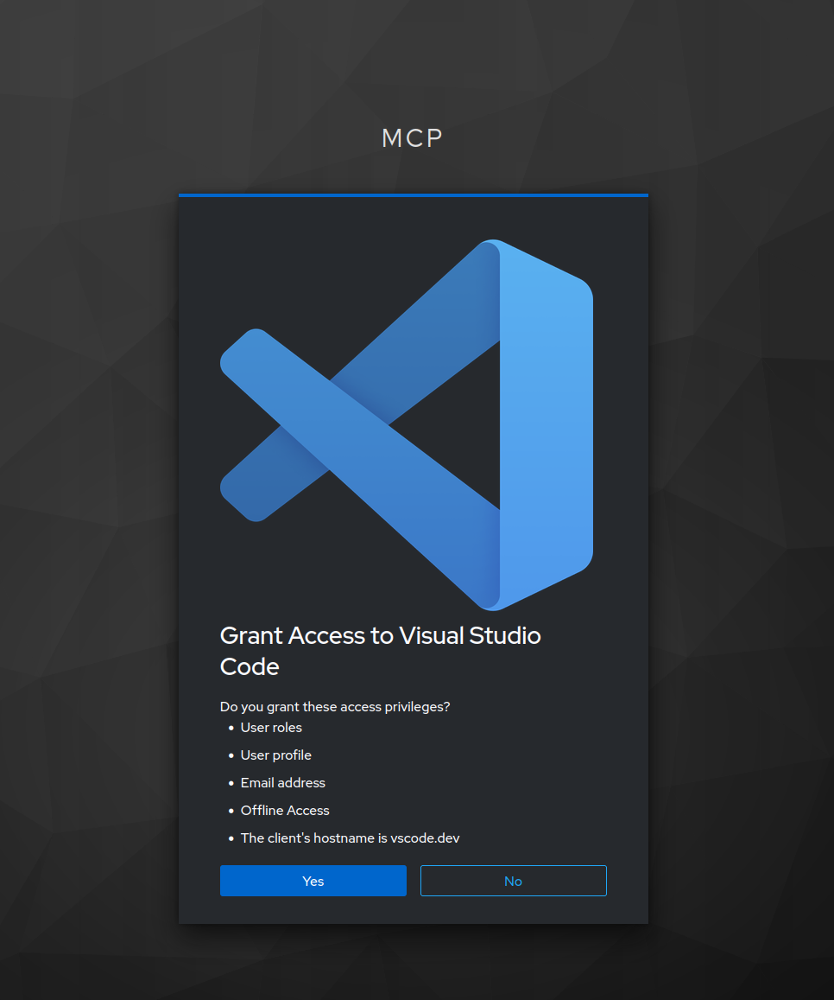
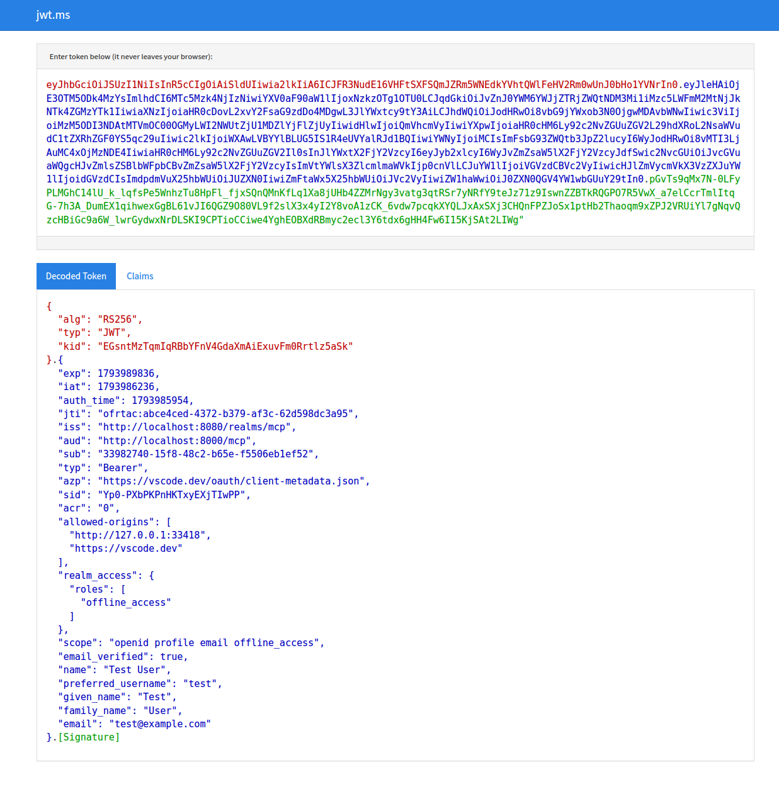
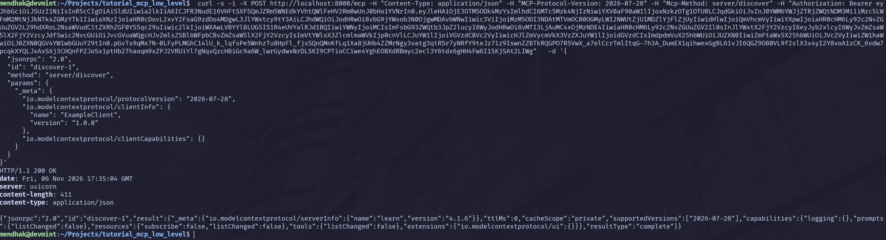

I like to understand what's happening behind the scenes with any technology, especially when a tool or protocol is usually introduced through prebuilt clients. In this tutorial we will use tools commonly found on Linux systems to send MCP requests ourselves, and see how a few of its features work. The focus will be on understanding the protocol, transports, and authentication at a low level, and gaining an insight into how MCP clients and servers communicate under the hood.

## Setup

Start by creating a folder for the tutorial, then a virtual environment with some dependencies that will be needed:  

```bash
mkdir -p tutorial_mcp_low_level
cd tutorial_mcp_low_level
uv init
uv sync
uv add fastmcp
source .venv/bin/activate
```


Create a `server.py` with a minimal MCP server setup. 

```python
from fastmcp import FastMCP

mcp = FastMCP("learn")

@mcp.tool()
def add(a: int, b: int) -> int:
    """Add two integers together!"""
    return a + b

```

This is a bare-bones MCP server with a single registered tool: `add`, which adds two integers together.


## Start the server

We can now start the MCP server and have it listen over stdio. stdio stands for standard input/output, which means the server will communicate over the terminal's input and output streams.

```bash
fastmcp run server.py:mcp --transport stdio
```

The MCP server starts, but it may appear as though nothing is happening. In fact, it's waiting for commands from clients.

## Discover command

The first command to send is the discover command, which asks the server to list what it's capable of. Most MCP clients will call discover automatically as part of the initial handshake. According to the spec, the discover command has the following structure.

```json
{
  "jsonrpc": "2.0",
  "id": "discover-1",
  "method": "server/discover",
  "params": {
    "_meta": {
      "io.modelcontextprotocol/protocolVersion": "2026-07-28",
      "io.modelcontextprotocol/clientInfo": {
        "name": "ExampleClient",
        "version": "1.0.0"
      },
      "io.modelcontextprotocol/clientCapabilities": {}
    }
  }
}
```

The `id` field is a unique identifier for the request, which allows the client to match responses with requests. The `method` is the method we're calling, in this case `server/discover`. The `_meta` field contains information about the client. The protocol version we're passing is `2026-07-28`. This matters because the protocol has changed significantly since earlier versions.

The stdio transport expects single-line JSON messages, so we can't just paste the formatted JSON above. Try pasting this single-line version instead, and you should see a similar response from the server.

```bash
$ fastmcp run server.py:mcp --transport stdio
{  "jsonrpc": "2.0", "id": "discover-1","method": "server/discover","params": {"_meta": {"io.modelcontextprotocol/protocolVersion": "2026-07-28", "io.modelcontextprotocol/clientInfo": { "name": "ExampleClient", "version": "1.0.0" },"io.modelcontextprotocol/clientCapabilities":{}}}}

{"jsonrpc":"2.0","id":"discover-1","result":{"cacheScope":"private","capabilities":{"prompts":{"listChanged":true},"resources":{"listChanged":true,"subscribe":true},"tools":{"listChanged":true}},"resultType":"complete","supportedVersions":["2026-07-28"],"ttlMs":0,"_meta":{"io.modelcontextprotocol/serverInfo":{"name":"learn","version":""}}}}
```

The `id` of the response matches the `id` of the request. Under `capabilities` are the different features the server supports, which we'll get into soon. Under `supportedVersions` we can see that the server supports the same MCP version "2026-07-28". 

This request-response cycle demonstrates how MCP clients interact with local MCP servers, sending requests and receiving responses in a structured JSON format. If you've ever added an MCP server in VS Code with a command like `npx` or `uvx`, this is essentially what happens under the hood: VS Code launches the server process and communicates with it using JSON-RPC messages.

Press Ctrl+C a few times to stop the server process. 

## Discover command with `jq`

Let's make the discover call again, piping the formatted JSON through `jq` to turn it into a single line for the server and pretty-printing the response for easier reading.


```bash
 $ echo '{
  "jsonrpc": "2.0",
  "id": "discover-1",
  "method": "server/discover",
  "params": {
    "_meta": {
      "io.modelcontextprotocol/protocolVersion": "2026-07-28",
      "io.modelcontextprotocol/clientInfo": {
        "name": "ExampleClient",
        "version": "1.0.0"
      },
      "io.modelcontextprotocol/clientCapabilities": {}
    }
  }
}' | jq -c | fastmcp run server.py:mcp --transport stdio | jq

{
  "jsonrpc": "2.0",
  "id": "discover-1",
  "result": {
    "_meta": {
      "io.modelcontextprotocol/serverInfo": {
        "name": "learn",
        "version": "4.1.6"
      }
    },
    "ttlMs": 0,
    "cacheScope": "private",
    "supportedVersions": [
      "2026-07-28"
    ],
    "capabilities": {
      "logging": {},
      "prompts": {
        "listChanged": false
      },
      "resources": {
        "subscribe": false,
        "listChanged": false
      },
      "tools": {
        "listChanged": false
      },
      "extensions": {
        "io.modelcontextprotocol/ui": {}
      }
    },
    "resultType": "complete"
  }
}
```

That's much more readable. 

## List tools

Next, issue a `tools/list` command to list all available tools. Its payload is quite similar to the discover command.

```bash
echo '{
  "jsonrpc": "2.0",
  "id": "tools-1",
  "method": "tools/list",
  "params": {
    "_meta": {
      "io.modelcontextprotocol/protocolVersion": "2026-07-28",
      "io.modelcontextprotocol/clientCapabilities": {}
    }
  }
}' | jq -c | fastmcp run server.py:mcp --transport stdio | jq

{
  "jsonrpc": "2.0",
  "id": "tools-1",
  "result": {
    "cacheScope": "private",
    "resultType": "complete",
    "tools": [
      {
        "_meta": {
          "fastmcp": {
            "tags": []
          }
        },
        "description": "Add two integers together!",
        "inputSchema": {
          "type": "object",
          "additionalProperties": false,
          "properties": {
            "a": {
              "type": "integer"
            },
            "b": {
              "type": "integer"
            }
          },
          "required": [
            "a",
            "b"
          ]
        },
        "name": "add",
        "outputSchema": {
          "properties": {
            "result": {
              "type": "integer"
            }
          },
          "required": [
            "result"
          ],
          "type": "object",
          "x-fastmcp-wrap-result": true
        },
        "title": "Add"
      }
    ],
    "ttlMs": 0,
    "_meta": {
      "io.modelcontextprotocol/serverInfo": {
        "name": "learn",
        "version": "4.1.6"
      }
    }
  }
}
```

The description comes from the method's docstring, and the input/output schemas are derived from the method's type annotations. With this, we have enough information to call the tool correctly. 


## Call the tool

Let's call the `add` tool and add 5 and 3, which we pass in the params as arguments.  

```bash
$ (echo '{
  "jsonrpc": "2.0",
  "id": "call-add-1",
  "method": "tools/call",
  "params": {
    "_meta": {
      "io.modelcontextprotocol/protocolVersion": "2026-07-28",
      "io.modelcontextprotocol/clientCapabilities": {}
    },
    "name": "add",
    "arguments": {
      "a": 5,
      "b": 3
    }
  }
}' | jq -c ; sleep 1) | fastmcp run server.py:mcp --transport stdio | jq

{
  "jsonrpc": "2.0",
  "id": "call-add-1",
  "result": {
    "_meta": {
      "fastmcp": {
        "wrap_result": true
      },
      "io.modelcontextprotocol/serverInfo": {
        "name": "learn",
        "version": "4.1.6"
      }
    },
    "content": [
      {
        "text": "8",
        "type": "text"
      }
    ],
    "isError": false,
    "resultType": "complete",
    "structuredContent": {
      "result": 8
    }
  }
}
```

We can see the result of calling the tool which correctly returns the sum of 5 and 3. 

## Resources and prompts

While tools are a common feature of MCP servers, MCP can do more than that. Resources let clients retrieve data, assets, configuration, or other content. Prompts provide a way of interacting with other LLMs through reusable message templates. 

Add the following code to the MCP server to define a resource and a prompt. The resource example returns a simple table of users, and the prompt returns a hard-coded response to any question.

```python
@mcp.resource("database://users")
def users_table() -> list[dict]:
    """Return a table of the users"""
    return [
        {"id": 1, "name": "Alice"},
        {"id": 2, "name": "Bob"},
    ]


@mcp.prompt()
def ask_question(question: str) -> str:
    """Ask a question and get an answer"""
    return f"You asked: {question} but there is no answer."
```

Restart the MCP server so that the new endpoints are picked up.

## List and call the resources

Similar to before, use `resources/list` to list the available resources: 

```bash
$ echo '{
  "jsonrpc": "2.0",
  "id": "resource-1",
  "method": "resources/list",
  "params": {
    "_meta": {
      "io.modelcontextprotocol/protocolVersion": "2026-07-28",
      "io.modelcontextprotocol/clientCapabilities": {}
    }
  }
}' | jq -c | fastmcp run server.py:mcp --transport stdio  | jq

{
  "jsonrpc": "2.0",
  "id": "resource-1",
  "result": {
    "cacheScope": "private",
    "resources": [
      {
        "_meta": {
          "fastmcp": {
            "tags": []
          }
        },
        "description": "Return a table of the users",
        "mimeType": "text/plain",
        "name": "users_table",
        "uri": "database://users"
      }
    ],
    "resultType": "complete",
    "ttlMs": 0,
    "_meta": {
      "io.modelcontextprotocol/serverInfo": {
        "name": "learn",
        "version": "4.1.6"
      }
    }
  }
}
```

And then call it to get the contents of the `users_table` resource. Notice that the payload uses the `uri` of the resource rather than its name. 

```bash
$ (echo '{
  "jsonrpc": "2.0",
  "id": "get-users-table-1",
  "method": "resources/read",
  "params": {
    "_meta": {
      "io.modelcontextprotocol/protocolVersion": "2026-07-28",
      "io.modelcontextprotocol/clientCapabilities": {}
    },
    "uri": "database://users"
  }
}' | jq -c ; sleep 1) | fastmcp run server.py:mcp --transport stdio  | jq


{
  "jsonrpc": "2.0",
  "id": "get-users-table-1",
  "result": {
    "cacheScope": "private",
    "contents": [
      {
        "mimeType": "text/plain",
        "text": "[{\"id\": 1, \"name\": \"Alice\"}, {\"id\": 2, \"name\": \"Bob\"}]",
        "uri": "database://users"
      }
    ],
    "resultType": "complete",
    "ttlMs": 0,
    "_meta": {
      "io.modelcontextprotocol/serverInfo": {
        "name": "learn",
        "version": "4.1.6"
      }
    }
  }
}
```

## List and call the prompt


```bash
$ (echo '{
  "jsonrpc": "2.0",
  "id": "prompt-1",
  "method": "prompts/list",
  "params": {
    "_meta": {
      "io.modelcontextprotocol/protocolVersion": "2026-07-28",
      "io.modelcontextprotocol/clientCapabilities": {}
    }
  }
}' | jq -c; sleep 1) | fastmcp run server.py:mcp --transport stdio  | jq

{
  "jsonrpc": "2.0",
  "id": "prompt-1",
  "result": {
    "cacheScope": "private",
    "prompts": [
      {
        "_meta": {
          "fastmcp": {
            "tags": []
          }
        },
        "arguments": [
          {
            "name": "question",
            "required": true
          }
        ],
        "description": "Ask a question and get an answer",
        "name": "ask_question"
      }
    ],
    "resultType": "complete",
    "ttlMs": 0,
    "_meta": {
      "io.modelcontextprotocol/serverInfo": {
        "name": "learn",
        "version": "4.1.6"
      }
    }
  }
}
```

Now let's call that prompt. 


```bash
$ (echo '{
  "jsonrpc": "2.0",
  "id": "get-prompt-1",
  "method": "prompts/get",
  "params": {
    "_meta": {
      "io.modelcontextprotocol/protocolVersion": "2026-07-28",
      "io.modelcontextprotocol/clientCapabilities": {}
    },
    "name": "ask_question",
    "arguments": {
      "question": "What is MCP?"
    }
  }
}' | jq -c ; sleep 1) | fastmcp run server.py:mcp --transport stdio  | jq

{
  "jsonrpc": "2.0",
  "id": "get-prompt-1",
  "result": {
    "description": "Ask a question and get an answer",
    "messages": [
      {
        "content": {
          "text": "You asked: What is MCP? but there is no answer.",
          "type": "text"
        },
        "role": "user"
      }
    ],
    "resultType": "complete",
    "_meta": {
      "io.modelcontextprotocol/serverInfo": {
        "name": "learn",
        "version": "4.1.6"
      }
    }
  }
}
```

## MCP over HTTP

So far we've been interacting with MCP over the standard input/output transport, which is suitable for local environments. MCP can also be used over HTTP, which allows for interacting with remote servers and services. 

FastMCP provides a way of serving the same MCP interface over HTTP. Start the HTTP server by running:

```bash
fastmcp run server.py:mcp --transport http --port 8000
```

The MCP server is now listening on http://localhost:8000. Let's go through the same methods as before, but using `curl` commands. 

The payload for the requests is exactly the same as before, but we _additionally_ need to add HTTP headers to indicate the protocol version and method being called. 

The discover request

```bash
$ curl -s -X POST http://localhost:8000/mcp -H "Content-Type: application/json" -H "MCP-Protocol-Version: 2026-07-28" -H "Mcp-Method: server/discover" -d '{     
  "jsonrpc": "2.0",
  "id": "discover-1",
  "method": "server/discover",
  "params": {
    "_meta": {
      "io.modelcontextprotocol/protocolVersion": "2026-07-28",
      "io.modelcontextprotocol/clientInfo": {
        "name": "ExampleClient",
        "version": "1.0.0"
      },
      "io.modelcontextprotocol/clientCapabilities": {}
    }
  }
}' | jq

{
  "jsonrpc": "2.0",
  "id": "discover-1",
  "result": {
    "_meta": {
      "io.modelcontextprotocol/serverInfo": {
        "name": "learn",
        "version": "4.1.6"
      }
    },
    "ttlMs": 0,
    "cacheScope": "private",
    "supportedVersions": [
      "2026-07-28"
    ],
    "capabilities": {
      "logging": {},
      "prompts": {
        "listChanged": false
      },
      "resources": {
        "subscribe": false,
        "listChanged": false
      },
      "tools": {
        "listChanged": false
      },
      "extensions": {
        "io.modelcontextprotocol/ui": {}
      }
    },
    "resultType": "complete"
  }
}
```

Next, we list the tools

```bash
$ curl -s -X POST http://localhost:8000/mcp -H "Content-Type: application/json" -H "MCP-Protocol-Version: 2026-07-28" -H "Mcp-Method: tools/list" -d '{     
  "jsonrpc": "2.0",
  "id": "tools-1",
  "method": "tools/list",
  "params": {
    "_meta": {
      "io.modelcontextprotocol/protocolVersion": "2026-07-28",
      "io.modelcontextprotocol/clientCapabilities": {}
    }
  }
}' | jq

{
  "jsonrpc": "2.0",
  "id": "tools-1",
  "result": {
    "cacheScope": "private",
    "resultType": "complete",
    "tools": [
      {
        "_meta": {
          "fastmcp": {
            "tags": []
          }
        },
        "description": "Add two integers together!",
        "inputSchema": {
          "type": "object",
          "additionalProperties": false,
          "properties": {
            "a": {
              "type": "integer"
            },
            "b": {
              "type": "integer"
            }
          },
          "required": [
            "a",
            "b"
          ]
        },
        "name": "add",
        "outputSchema": {
          "properties": {
            "result": {
              "type": "integer"
            }
          },
          "required": [
            "result"
          ],
          "type": "object",
          "x-fastmcp-wrap-result": true
        },
        "title": "Add"
      }
    ],
    "ttlMs": 0,
    "_meta": {
      "io.modelcontextprotocol/serverInfo": {
        "name": "learn",
        "version": "4.1.6"
      }
    }
  }
}
```

And now to call the tool, this time notice the headers being passed - protocol version, method, and name.  


```bash
$ curl -s -X POST http://localhost:8000/mcp -H "Content-Type: application/json" -H "MCP-Protocol-Version: 2026-07-28" -H "Mcp-Method: tools/call" -H "Mcp-Name: add" -d '{
  "jsonrpc": "2.0",
  "id": "call-add-1",
  "method": "tools/call",
  "params": {
    "_meta": {
      "io.modelcontextprotocol/protocolVersion": "2026-07-28",
      "io.modelcontextprotocol/clientCapabilities": {}
    },
    "name": "add",
    "arguments": {
      "a": 5,
      "b": 3
    }
  }
}' | jq

{
  "jsonrpc": "2.0",
  "id": "call-add-1",
  "result": {
    "_meta": {
      "fastmcp": {
        "wrap_result": true
      },
      "io.modelcontextprotocol/serverInfo": {
        "name": "learn",
        "version": "4.1.6"
      }
    },
    "content": [
      {
        "text": "8",
        "type": "text"
      }
    ],
    "isError": false,
    "resultType": "complete",
    "structuredContent": {
      "result": 8
    }
  }
}
```

Just for completeness let's also call a resource. This time it's the resource URI which goes into the `Mcp-Name` headers. 


```bash
 curl -s -X POST http://localhost:8000/mcp -H "Content-Type: application/json" -H "MCP-Protocol-Version: 2026-07-28" -H "Mcp-Method: resources/read" -H "Mcp-Name: database://users"  -d '{
  "jsonrpc": "2.0",
  "id": "get-users-table-1",
  "method": "resources/read",
  "params": {
    "_meta": {
      "io.modelcontextprotocol/protocolVersion": "2026-07-28",
      "io.modelcontextprotocol/clientCapabilities": {}
    },
    "uri": "database://users"
  }
}' | jq

{
  "jsonrpc": "2.0",
  "id": "get-users-table-1",
  "result": {
    "cacheScope": "private",
    "contents": [
      {
        "mimeType": "text/plain",
        "text": "[{\"id\": 1, \"name\": \"Alice\"}, {\"id\": 2, \"name\": \"Bob\"}]",
        "uri": "database://users"
      }
    ],
    "resultType": "complete",
    "ttlMs": 0,
    "_meta": {
      "io.modelcontextprotocol/serverInfo": {
        "name": "learn",
        "version": "4.1.6"
      }
    }
  }
}
```

And a prompt

```bash
curl -s -X POST http://localhost:8000/mcp -H "Content-Type: application/json" -H "MCP-Protocol-Version: 2026-07-28" -H "Mcp-Method: prompts/get" -H "Mcp-Name: ask_question"  -d '{     
  "jsonrpc": "2.0",
  "id": "get-prompt-1",
  "method": "prompts/get",
  "params": {
    "_meta": {
      "io.modelcontextprotocol/protocolVersion": "2026-07-28",
      "io.modelcontextprotocol/clientCapabilities": {}
    },
    "name": "ask_question",
    "arguments": {
      "question": "What is MCP?"
    }
  }
}' | jq

{
  "jsonrpc": "2.0",
  "id": "get-prompt-1",
  "result": {
    "description": "Ask a question and get an answer",
    "messages": [
      {
        "content": {
          "text": "You asked: What is MCP? but there is no answer.",
          "type": "text"
        },
        "role": "user"
      }
    ],
    "resultType": "complete",
    "_meta": {
      "io.modelcontextprotocol/serverInfo": {
        "name": "learn",
        "version": "4.1.6"
      }
    }
  }
}
```

## HTTP Streaming


MCPs support HTTP streaming, which allows tools to emit partial results as they become available, or to report progress over time. This is often seen during chat interactions as portions of the response are generated and sent to the client. 

We'll add a simple tool, `slow_count`, that counts to a given number and reports progress along the way. Edit the `server.py` file; at this point, the entire file should look like this:

```python
import asyncio
from fastmcp import Context, FastMCP

mcp = FastMCP("learn")


@mcp.tool()
def add(a: int, b: int) -> int:
    """Add two integers together!"""
    return a + b


@mcp.resource("database://users")
def users_table() -> list[dict]:
    """Return a table of the users"""
    return [
        {"id": 1, "name": "Alice"},
        {"id": 2, "name": "Bob"},
    ]


@mcp.prompt()
def ask_question(question: str) -> str:
    """Ask a question and get an answer"""
    return f"You asked: {question} but there is no answer."


@mcp.tool()
async def slow_count(n: int, ctx: Context) -> str:
    """Count to n, reporting progress each second"""
    for i in range(1, n + 1):
        await asyncio.sleep(1)
        await ctx.report_progress(i, n, f"Counted {i}")
    return f"Done! Counted to {n}"

```

Restart the server. 

```bash
fastmcp run server.py:mcp --transport http --port 8000
```

Now call the `slow_count` tool. Notice how progress notifications arrive as it counts, followed by the final result.

```bash

curl -N http://localhost:8000/mcp \
  -H 'Content-Type: application/json' \
  -H 'Accept: application/json, text/event-stream' \
  -H 'Mcp-Protocol-Version: 2026-07-28' \
  -H 'Mcp-Method: tools/call' \
  -H 'Mcp-Name: slow_count' \
  -d '{
    "jsonrpc": "2.0",
    "id": "slow-1",
    "method": "tools/call",
    "params": {
      "_meta": {
        "io.modelcontextprotocol/protocolVersion": "2026-07-28",
        "io.modelcontextprotocol/clientCapabilities": {},
        "progressToken": "p1"
      },
      "name": "slow_count",
      "arguments": {"n": 5}
    }
  }'

event: message
data: {"jsonrpc":"2.0","method":"notifications/progress","params":{"progressToken":"p1","progress":1.0,"total":5.0,"message":"Counted 1"}}

event: message
data: {"jsonrpc":"2.0","method":"notifications/progress","params":{"progressToken":"p1","progress":2.0,"total":5.0,"message":"Counted 2"}}

event: message
data: {"jsonrpc":"2.0","method":"notifications/progress","params":{"progressToken":"p1","progress":3.0,"total":5.0,"message":"Counted 3"}}

event: message
data: {"jsonrpc":"2.0","method":"notifications/progress","params":{"progressToken":"p1","progress":4.0,"total":5.0,"message":"Counted 4"}}

event: message
data: {"jsonrpc":"2.0","method":"notifications/progress","params":{"progressToken":"p1","progress":5.0,"total":5.0,"message":"Counted 5"}}

event: message
data: {"jsonrpc":"2.0","id":"slow-1","result":{"_meta":{"fastmcp":{"wrap_result":true},"io.modelcontextprotocol/serverInfo":{"name":"learn","version":"4.1.6"}},"content":[{"text":"Done! Counted to 5","type":"text"}],"isError":false,"resultType":"complete","structuredContent":{"result":"Done! Counted to 5"}}}

```

## HTTP with authentication

And now on to everyone's favourite topic - security! So far we've been making unauthenticated HTTP requests. In this section we'll add authentication to the MCP server, and to do this there are going to be a few moving parts involved. 

We will need an identity server, for that we will use Keycloak; don't worry I have a preconfigured setup ready to go for this. 

We will also need to configure the MCP server to require an access token, issued by that identity server, for incoming requests. 

However, it isn't enough to let any MCP client connect. In the MCP 2026-07-28 protocol, clients are expected to be pre-registered with the identity server and have an online JSON URL registered. This is known as the Client ID Metadata Document (CIMD).

As an example, the CIMD URL for VSCode is https://vscode.dev/oauth/client-metadata.json 

Looking at its contents, 

```json
{
  "client_name": "Visual Studio Code",
  "logo_uri": "https://code.visualstudio.com/assets/branding/code-stable.png",
  "grant_types": [
    "authorization_code",
    "refresh_token",
    "urn:ietf:params:oauth:grant-type:device_code"
  ],
  "response_types": [
    "code"
  ],
  "token_endpoint_auth_method": "none",
  "application_type": "native",
  "client_id": "https://vscode.dev/oauth/client-metadata.json",
  "client_uri": "https://vscode.dev/product",
  "redirect_uris": [
    "http://127.0.0.1:33418/",
    "https://vscode.dev/redirect"
  ]
}
```

We see a few different fields here used as part of the authentication flow. We need to register these details with Keycloak so that it knows about the client and can issue tokens. As part of CIMD flow, clients will pass the Client ID as the CIMD URL itself, and the identity server will fetch and match the metadata being passed against what has been registered. 

### Keycloak setup

Grab the following two files: 

- [docker-compose.yml](https://github.com/mendhak/mcp_tutorial_low_level/blob/main/docker-compose.yml)
- [realm.json](https://github.com/mendhak/mcp_tutorial_low_level/blob/main/realm.json)

Take a moment to skim through the `realm.json` and you should see the VSCode details above present here. 

Place those in the same directory as your MCP server setup files. Bring up the Keycloak server: 


```bash
docker compose up
```

And after a few minutes, Keycloak should be ready. You can browse Keycloak at http://localhost:8080 to access the admin console, use the credentials `admin`/`admin`. 

You will find a [client profile](http://localhost:8080/admin/master/console/#/mcp/realm-settings/client-policies/cimd-profile/edit-profile) and a [client policy](http://localhost:8080/admin/master/console/#/mcp/realm-settings/client-policies/cimd-policy/edit-policy/client-id-uri/edit-condition) configured for VSCode's metadata. 

### OAuth configuration

We now need to modify the `server.py` file to include OAuth configuration to point at Keycloak. The entire file should look like this:


```python
import asyncio
from fastmcp import Context, FastMCP
from fastmcp.server.auth import RemoteAuthProvider
from fastmcp.server.auth.providers.jwt import JWTVerifier
from pydantic import AnyHttpUrl


ISSUER = "http://localhost:8080/realms/mcp"
AUDIENCE = "http://localhost:8000/mcp"  

auth = RemoteAuthProvider(
    token_verifier=JWTVerifier(
        jwks_uri=f"{ISSUER}/protocol/openid-connect/certs",
        issuer=ISSUER,
        audience=AUDIENCE,
        algorithm="RS256",
    ),
    authorization_servers=[AnyHttpUrl(ISSUER)],
    base_url="http://localhost:8000",
)

mcp = FastMCP("learn", auth=auth)


@mcp.tool()
def add(a: int, b: int) -> int:
    """Add two integers together!"""
    return a + b


@mcp.resource("database://users")
def users_table() -> list[dict]:
    """Return a table of the users"""
    return [
        {"id": 1, "name": "Alice"},
        {"id": 2, "name": "Bob"},
    ]


@mcp.prompt()
def ask_question(question: str) -> str:
    """Ask a question and get an answer"""
    return f"You asked: {question} but there is no answer."


@mcp.tool()
async def slow_count(n: int, ctx: Context) -> str:
    """Count to n, reporting progress each second"""
    for i in range(1, n + 1):
        await asyncio.sleep(1)
        await ctx.report_progress(i, n, f"Counted {i}")
    return f"Done! Counted to {n}"


```

The Issuer points to our Keycloak realm, and the Audience must match the URL of the MCP server being called. 


### Working through the OAuth flow


Now run the web server again

```bash
fastmcp run server.py:mcp --transport http --port 8000
```

And try the discover endpoint once more, but this time you should get an HTTP 401 response. 


```bash
 curl -s -i -X POST http://localhost:8000/mcp -H "Content-Type: application/json" -H "MCP-Protocol-Ve
rsion: 2026-07-28" -H "Mcp-Method: server/discover" -d '{     
  "jsonrpc": "2.0",
  "id": "discover-1",
  "method": "server/discover",
  "params": {
    "_meta": {
      "io.modelcontextprotocol/protocolVersion": "2026-07-28",
      "io.modelcontextprotocol/clientInfo": {
        "name": "ExampleClient",
        "version": "1.0.0"
      },
      "io.modelcontextprotocol/clientCapabilities": {}
    }
  }
}' 
HTTP/1.1 401 Unauthorized
date: Fri, 06 Nov 2026 16:51:00 GMT
server: uvicorn
content-length: 0
www-authenticate: Bearer resource_metadata="http://localhost:8000/.well-known/oauth-protected-resource/mcp"
```
Notice that the `www-authenticate` response header indicates that the resource is protected by OAuth and provides the URL for the resource metadata. This tells the client that it needs to obtain a valid access token from the identity provider (Keycloak) to access the MCP server.

Let's query that URL

```bash
curl -s http://localhost:8000/.well-known/oauth-protected-resource/mcp | jq

{
  "resource": "http://localhost:8000/mcp",
  "authorization_servers": [
    "http://localhost:8080/realms/mcp"
  ],
  "scopes_supported": [],
  "bearer_methods_supported": [
    "header"
  ]
}
```

The authorization_servers points to `http://localhost:8080/realms/mcp` which is the Keycloak realm that was configured earlier. 


We can now call Keycloak's well known openid-configuration endpoint. Its response is massive, so I've truncated it to just the important bit:


```bash
$ curl -s http://localhost:8080/realms/mcp/.well-known/openid-configuration | jq
{
  "issuer": "http://localhost:8080/realms/mcp",
  "authorization_endpoint": "http://localhost:8080/realms/mcp/protocol/openid-connect/auth",
  ...
  ...
  "client_id_metadata_document_supported": true
}
```

The `client_id_metadata_document_supported` indicates support for CIMD (Client ID Metadata Documents), so the client then knows how to proceed by generating a login URL for the user to authenticate, and obtain an access token. 

Let's actually do this, in the spirit of being low level, by going through the login process. Start by generating a login URL. 


```bash
CODE_VERIFIER=$(openssl rand -base64 32 | tr '+/' '-_' | tr -d '=')
echo "CODE_VERIFIER=$CODE_VERIFIER"
CODE_CHALLENGE=$(printf '%s' "$CODE_VERIFIER" | openssl dgst -sha256 -binary | openssl base64 -A | tr '+/' '-_' | tr -d '=')

URL="http://localhost:8080/realms/mcp/protocol/openid-connect/auth?client_id=https://vscode.dev/oauth/client-metadata.json&response_type=code&code_challenge=${CODE_CHALLENGE}&code_challenge_method=S256&scope=openid+offline_access&resource=http://localhost:8000/mcp&redirect_uri=http://127.0.0.1:33418/&state=$(openssl rand -base64 16 | tr '+/' '-_' | tr -d '=')"
echo "$URL"
echo "$CODE_VERIFIER"
```

Take a moment to study the URL, notice that the client ID is set to VSCode's CIMD URL. That code verifier will be used later, so keep it in mind.    

Copy the URL into a browser and begin the login process, using `test`/`test` as the login credentials. After logging in, you'll see a consent screen: "Grant Access to Visual Studio Code."



After granting access, the browser will attempt to redirect to the `redirect_uri` from earlier, but nothing is listening there, so the page fails to load. That's expected; we can still carry on.

Suppose we were being redirected to the following URL after granting access:

```
http://127.0.0.1:33418/?state=47_CseCkvgkokQIgEfNoUQ&session_state=Yp0-PXbPKPnHKTxyEXjTIwPP&iss=http%3A%2F%2Flocalhost%3A8080%2Frealms%2Fmcp&code=cfb09146-a79d-5644-d49c-c634d9303329.Yp0-PXbPKPnHKTxyEXjTIwPP.2d6c0e01-527a-4f6f-aa0b-673fdee407b6
```

We grab the `code` value from the URL, and then using the code_verifier from our URL generation step, we request an access token. 

```
curl -s -X POST http://localhost:8080/realms/mcp/protocol/openid-connect/token \
  -d grant_type=authorization_code \
  -d code=cfb09146-a79d-5644-d49c-c634d9303329.Yp0-PXbPKPnHKTxyEXjTIwPP.2d6c0e01-527a-4f6f-aa0b-673fdee407b6 \
  -d redirect_uri=http://127.0.0.1:33418/ \
  -d code_verifier=$CODE_VERIFIER \
  -d client_id=https://vscode.dev/oauth/client-metadata.json

```

This gives us an access token in the response, which I've truncated:

```
{"access_token":"eyJh.....
```

We can inspect that access token in a JWT decoder such as [jwt.ms](https://jwt.ms)



where we can see the audience matching our MCP server's URL. 

And finally, now that we have an access token, we can use it to call the discover endpoint of our MCP server, this time with the access token included in the Authorization header:

```bash
curl -s -i -X POST http://localhost:8000/mcp -H "Content-Type: application/json" -H "MCP-Protocol-Version: 2026-07-28" -H "Mcp-Method: server/discover" -H "Authorization: Bearer eyJ...." \
  -d '{     
  "jsonrpc": "2.0",
  "id": "discover-1",
  "method": "server/discover",
  "params": {
    "_meta": {
      "io.modelcontextprotocol/protocolVersion": "2026-07-28",
      "io.modelcontextprotocol/clientInfo": {
        "name": "ExampleClient",
        "version": "1.0.0"
      },
      "io.modelcontextprotocol/clientCapabilities": {}
    }
  }
}' 
```



After that, all subsequent requests are the same as before, just making sure to include the Authorization header. 


In case you haven't spotted the security hole here, due to the localhost redirect URIs involved, the MCP CIMD mechanism allows us to impersonate any popular MCP client by obtaining access tokens on behalf of them. From the authorization server's perspective, they are non the wiser, they think we are the legitimate client requesting access. Additionally, the Client ID being a URL immediately introduces the risk of SSRF attacks as we're effecting telling the authorization server to fetch arbitrary URLs. 

As is evident here, MCP's security model continues to be an afterthought, and it should not be a surprise if it goes through a number of revisions in the future. 


## Now try it high level

Because we've already gone through the setup steps for VSCode, we can now go through the act of adding an MCP server and watch as it goes through what we've done above. 

Create a file, `.mcp.json` with the following contents

```json
{
 "mcpServers": {
		"my_mcp_test": {
		"url": "http://localhost:8000/mcp",
		"type": "http"
	}
 }
}
```

Click Start above the `my_mcp_test` entry in VSCode, which should prompt you for authentication. It opens a browser and goes through the authorization flow, obtains a token, then initiates communication with the  discover endpoint, and fetches the tools, resources, and prompts available. 

As you watch this, you should be able to relate it to the low level steps we've gone through above. 

The [actual spec itself](https://modelcontextprotocol.io/specification/2026-07-28/architecture) should now make much more sense, and it should become easier to grasp some of the features I haven't covered, such as [elicitation](https://modelcontextprotocol.io/specification/2026-07-28/client/elicitation) which lets servers request additional information from users, and notifying clients of [changes to the list of available tools](https://modelcontextprotocol.io/specification/2024-11-05/server/tools#list-changed-notification). 
